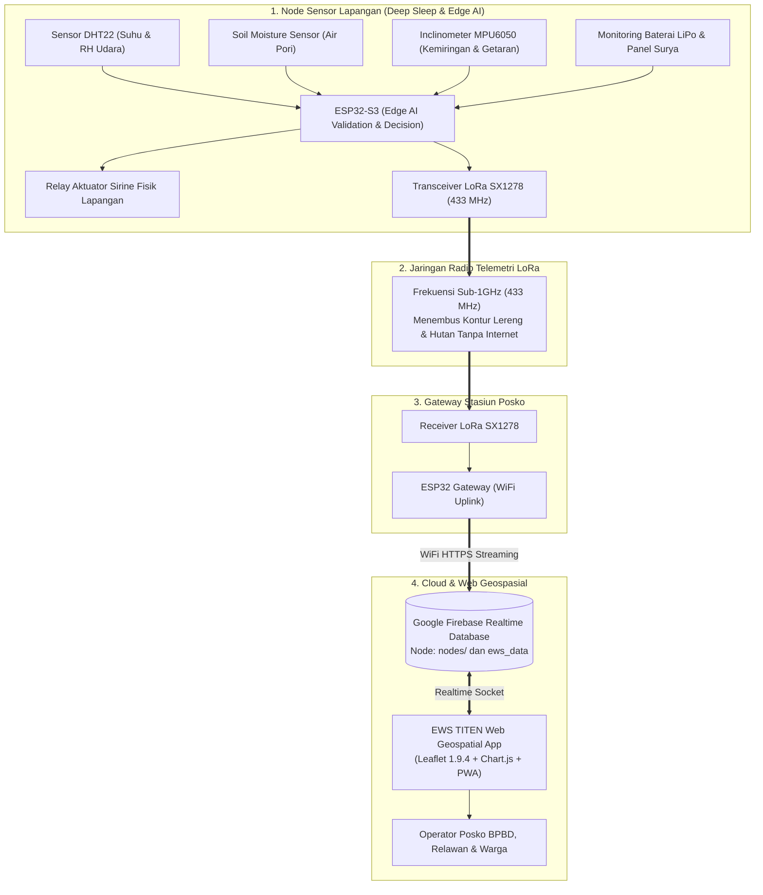

<p align="center">
  
</p>

# 🛰️ TITEN — Early Warning System (EWS)
### Sistem Peringatan Dini IoT Bencana Tanah Longsor & Karhutla Berbasis LoRa & Peta Interaktif

[](https://mage-its.id)
[](https://github.com)
[](https://smkbudiluhur.sch.id)
[](https://titenv2.pages.dev)

---

## 📌 Daftar Isi
1. [Deskripsi Proyek](#-deskripsi-proyek)
2. [Arsitektur Sistem & Alur Data](#-arsitektur-sistem--alur-data)
3. [Fitur Unggulan Aplikasi Peta Interaktif](#-fitur-unggulan-aplikasi-peta-interaktif)
4. [Tabel Ambang Batas & Rujukan Standar](#-tabel-ambang-batas--rujukan-standar)
5. [Struktur Direktori Repositori](#-struktur-direktori-repositori)
6. [Panduan Menjalankan Secara Lokal](#-panduan-menjalankan-secara-lokal)
7. [Panduan Deploy ke Cloudflare Pages](#-panduan-deploy-ke-cloudflare-pages)
8. [Struktur Database Firebase & Aturan Keamanan](#-struktur-database-firebase--aturan-keamanan)
9. [Panduan Mode Demo Juri (?demo=1)](#-panduan-mode-demo-juri-demo1)
10. [Skrip Demo 3 Menit untuk Dewan Juri](#-skrip-demo-3-menit-untuk-dewan-juri)
11. [Daftar Periksa Sebelum Demo](#-daftar-periksa-sebelum-demo-juri-pre-demo-checklist)
12. [Lembar Cetak QR Code Booth](#-lembar-cetak-qr-code-booth-qrhtml)
13. [Daftar Keputusan Desain & Parameter Kalibrasi](#-daftar-keputusan-desain--parameter-kalibrasi)

---

## 📖 Deskripsi Proyek

**TITEN** (*Tanda Indikasi Tanah Longsor dan Kebakaran Hutan*) adalah sistem monitoring dan peringatan dini berbasis **Internet of Things (IoT)**, komunikasi radio nirkabel jarak jauh **LoRa 433 MHz (SX1278)**, dan **Peta Geospasial Interaktif Layar Penuh**. 

Sistem ini dirancang khusus untuk memitigasi bencana alam ganda di wilayah blank spot Indonesia (tanpa sinyal GSM/4G), yaitu **tanah longsor di lereng perbukitan** serta **kebakaran hutan dan lahan (karhutla)**.

Node pemantau dilengkapi dengan *Edge AI validation* untuk menyaring getaran angin/hewan guna meminimalisir alarm palsu (*false alarm*), serta siklus *deep sleep* berkala guna menghemat daya baterai LiPo yang didukung panel surya (*solar harvesting*).

---

## 🏗️ Arsitektur Sistem & Alur Data



---

## 💻 Fitur Unggulan Aplikasi Peta Interaktif

1. **Peta Layar Penuh dengan Animasi Zoom Pembuka (*Opening FlyTo*):**
   - Dimulai dari pandangan seluruh kepulauan Indonesia (`[-2.5, 118]`, zoom 5), kemudian bergerak halus (*flyTo*) menuju koordinat stasiun node di Surabaya (zoom 16) dengan indikator *"Menuju Node-01 · Surabaya"* dan tombol *"Lewati"*.
   - Mengikuti standar aksesibilitas `prefers-reduced-motion` (langsung menuju lokasi tanpa animasi jika diaktifkan pengguna) dan disimpan per sesi (*sessionStorage*).

2. **Panel Detail Node Tersegmentasi:**
   - **Desktop:** Panel mengambang di sisi kiri dengan lebar tetap, dapat dilipat (*collapsible*).
   - **Mobile:** *Bottom sheet* interaktif yang ramah sentuhan (target sentuh minimal 44px).
   - **Hierarki Data:** Status ringkasan terlebih dahulu (blok ganda Longsor & Karhutla), diikuti tab detail: `Ringkasan`, `Longsor`, `Karhutla`, `Perangkat`, dan `Riwayat` (Grafik interaktif 6 jam / 24 jam / 7 hari dengan garis ambang batas).
   - Sensor tanpa data (seperti gas/asap) disembunyikan otomatis (tidak menampilkan `NaN` atau angka `0` palsu).

3. **Panel Layer & Legenda Gaya INARISK BNPB:**
   - Pilihan peta dasar: OpenStreetMap dan Satelit Esri World Imagery.
   - Pilihan layer bahaya: Lapisan 30m Indeks Bahaya Tanah Longsor resmi BNPB InaRISK, Radar Cuaca RainViewer, dan Titik Panas NASA FIRMS.
   - Legenda 4 level bahaya di pojok layar yang dinamis dan informatif.

4. **Banner Masalah Faktual (*Zero-Spam*):**
   - Banner peringatan hanya muncul saat ada masalah nyata: node offline, gateway offline, data lama (> 3 menit), atau baterai kritis. Tidak menampilkan banner "semua baik" yang memakan ruang.

5. **Audio Alarm Berbasis Kenaikan Level (Web Audio API):**
   - Peringatan suara berbunyi **hanya saat status bahaya mengalami kenaikan level** (bukan di setiap kedatangan paket data telemetri).
   - Tombol bisukan/aktifkan alarm mandiri per sesi.

---

## 📊 Tabel Ambang Batas & Rujukan Standar

Seluruh kalkulasi status, badge kartu, warna marker, dan garis grafik merujuk pada objek konfigurasi tunggal `CONFIG.THRESHOLDS` di [js/config.js](file:///c:/laragon/www/MAGE12_Tahap%202_IoT_TRILOGY/src%20code%20website%20titen/js/config.js):

| Sektor | Level Status | Parameter Pemicu | Respon Lapangan & Posko | Rujukan Standar Kebencanaan |
|:---|:---|:---|:---|:---|
| **Longsor** | **NORMAL** | Kemiringan < 12° dan Tanah < 60% | Patroli rutin, kondisi stabil | SNI 8460:2017 (Persyaratan Perancangan Geoteknik) |
| **Longsor** | **WASPADA** | Kemiringan ≥ 12° atau Tanah ≥ 60% | Pemantauan intensif, cek retakan | PVMBG Kelerengan Sedang (10°–15°) & Kejenuhan Air |
| **Longsor** | **SIAGA** | Kemiringan ≥ 20° atau (≥ 16° dan Tanah ≥ 70%) | Warga bersiap di zona aman | Pedoman Mitigasi Gerakan Tanah BNPB (Perka 02/2012) |
| **Longsor** | **AWAS** | Kemiringan > 30° atau (> 25° dan Tanah > 80%) | Evakuasi mandiri, sirine aktif | Kritis Geser Lereng Curam (>30°) & Ambang Likuifaksi |
| **Karhutla** | **NORMAL** | Suhu ≤ 34°C dan RH Udara > 45% | Kondisi vegetasi aman dan lembap | Sistem Peringkat Bahaya Kebakaran (FDRS) BMKG |
| **Karhutla** | **WASPADA** | Suhu ≥ 34°C atau RH Udara ≤ 45% | Larangan membakar sampah/lahan | FDRS BMKG (Kategori Sedang / Moderate Fire Danger) |
| **Karhutla** | **SIAGA** | Suhu ≥ 38°C atau (≥ 35°C dan RH ≤ 35%) | Siaga unit pemadam di posko | FDRS BMKG (Kategori Tinggi / High Fire Danger) |
| **Karhutla** | **AWAS** | Suhu > 45°C atau (≥ 40°C dan RH < 25%) | Respon darurat titik api aktif | FDRS BMKG Ekstrem (>40°C & Defisit Kelembaban Parah) |
| **Sistem** | **OFFLINE** | Tidak ada paket data > 180 detik | Cek baterai node & LoRa | 3x Siklus Deep Sleep (Watchdog Stale Data Timeout) |

---

## 📁 Struktur Direktori Repositori

```plaintext
src code website titen/
├── assets/                       # Berkas visual & PWA resmi TITEN
│   ├── logo-square.png           # 1024x1024 logo master
│   ├── logo-cropped.png          # 824x416 logo proporsional
│   ├── favicon.png               # 32x32 favicon
│   ├── apple-touch-icon.png      # 180x180 iOS touch icon
│   ├── icon-192.png              # 192x192 PWA icon
│   ├── icon-512.png              # 512x512 PWA icon
│   ├── icon-maskable-512.png     # 512x512 PWA maskable icon
│   └── og-image.png              # 1200x630 Open Graph preview
├── css/
│   └── style.css                 # Desain SCADA Geospasial, Dark & Light Mode, Responsif
├── js/
│   ├── config.js                 # Single source of truth (Ambang batas, layer, koordinat)
│   └── app.js                    # Lifecycle peta Leaflet, Firebase, Chart.js, Web Audio
├── functions/
│   └── api/
│       └── firms.js              # Cloudflare Pages Function Proxy NASA FIRMS (CORS & Caching)
├── _headers                      # Kebijakan Cache Cloudflare Pages
├── index.html                    # Struktur DOM aplikasi geospasial layar penuh
├── qr.html                       # Generator & lembar cetak QR code pameran
├── manifest.json                 # Manifest PWA Progressive Web App
├── sw.js                         # Service Worker offline cache busting (v3.1.0)
├── firebase.rules.json           # Aturan keamanan database Firebase
├── package.json                  # Skrip Node.js lokal
├── server.js                     # HTTP server lokal ringan
└── README.md                     # Berkas dokumentasi
```

---

## 🚀 Panduan Menjalankan Secara Lokal

### Menggunakan Server Node.js (Rekomendasi)
1. Buka terminal pada folder website:
   ```bash
   cd "src code website titen"
   ```
2. Jalankan server lokal:
   ```bash
   node server.js
   ```
3. Buka peramban di:
   ```
   http://localhost:8000
   ```

---

## ☁️ Panduan Deploy ke Cloudflare Pages

Karena aplikasi ini sepenuhnya statis (*pure HTML/CSS/Vanilla JS*), deploy ke **Cloudflare Pages** sangat cepat dan tanpa build step:

1. **Via Dashboard Cloudflare Pages (Direct Upload):**
   - Masuk ke dashboard Cloudflare (`dash.cloudflare.com`).
   - Pilih menu **Workers & Pages** $\rightarrow$ **Create Application** $\rightarrow$ **Pages** $\rightarrow$ **Upload Assets**.
   - Unggah seluruh isi folder `src code website titen` (bukan folder induk).
   - Klik **Deploy site**.
2. **Via Git Integration (GitHub / GitLab):**
   - Hubungkan repositori Git.
   - Atur pengaturan build:
     - **Build command:** *(Kosongkan)*
     - **Build output directory:** `src code website titen`
   - Klik **Save and Deploy**.
3. Sistem akan langsung online di domain Cloudflare Pages (misal: `titenv2.pages.dev`).

---

## 🎮 Panduan Mode Demo Juri (`?demo=1`)

Untuk keperluan gladi resik, presentasi panggung, dan demonstrasi interaktif di hadapan Dewan Juri MAGE 12:
1. Buka peramban dengan parameter query `?demo=1`:
   ```
   https://titenv2.pages.dev/?demo=1
   ```
2. **Perilaku Khusus Mode Demo:**
   - Muncul bilah kontrol simulasi (*Demo Dock*) di bagian bawah layar.
   - Peta memunculkan **2 node simulasi tambahan** di sekitar Surabaya (`Node-02 · Tebing Wonokromo` dan `Node-03 · Mangrove Rungkut`) berlabel jelas **"(SIMULASI)"** agar peta interaktif dan komparatif saat demonstrasi.
   - Tombol pengujian instan: `Offline`, `Normal`, `Waspada Longsor`, `Siaga Longsor`, `Awas Longsor`, `Waspada Karhutla`, dan `Awas Karhutla`.
   - **Aman:** Simulasi hanya memanipulasi memori lokal browser klien, **sama sekali tidak menimpa data telemetri riil di Firebase Realtime Database**.
3. Di mode normal (tanpa `?demo=1`), bilah dock dan node simulasi otomatis disembunyikan.

---

## ⏱️ Skrip Demo 3 Menit untuk Dewan Juri

Gunakan alur berikut saat presentasi langsung di booth pameran atau di hadapan dewan juri:

| Menit | Aksi / Klik di Web | Poin Narasi Presentasi yang Disampaikan |
|:---|:---|:---|
| **0:00 – 0:30** | Buka `?demo=1` $\rightarrow$ Biarkan animasi *FlyTo* berjalan (atau klik "Lewati"). Tunjukkan Topbar. | *"Selamat pagi Dewan Juri, ini adalah EWS TITEN. Peta otomatis terbang menuju stasiun pemantau di lereng Sukolilo Surabaya. Topbar menampilkan status koneksi independen: Gateway WiFi dan telemetri radio LoRa 433 MHz yang menembus area blank spot tanpa butuh kuota internet seluler."* |
| **0:30 – 1:00** | Klik tombol **"Normal"** di Demo Dock $\rightarrow$ Buka tab **"Ringkasan"** & tab **"Perangkat"**. | *"Dalam kondisi normal, panel detail menyajikan segmentasi cerdas dua bencana utama: Tanah Longsor dan Karhutla. Di tab Perangkat, juri dapat melihat daya baterai LiPo yang didukung panel surya serta kekuatan sinyal RSSI LoRa."* |
| **1:00 – 1:45** | Klik bertahap: **"Waspada Longsor"** $\rightarrow$ **"Siaga Longsor"** $\rightarrow$ **"Awas Longsor"**. | *"Ketika terjadi deformasi lereng dan kenaikan kelembapan air pori tanah, status otomatis naik. Perhatikan: saat mencapai AWAS (>30°), sistem menyalakan sirine audio darurat (Web Audio API), marker berdenyut merah di peta, relay sirine fisik di tiang aktif, dan kotak tindakan darurat menampilkan dua tombol panggilan cepat: Posko TRILOGY dan Call Center 112."* |
| **1:45 – 2:20** | Klik **"Waspada Karhutla"** $\rightarrow$ **"Awas Karhutla"** $\rightarrow$ Buka tab **"Karhutla"**. | *"Selain longsor, TITEN memitigasi bahaya kebakaran hutan. Sensor DHT22 memantau kombinasi suhu ekstrem dan kekeringan udara (RH < 25%). Ambang batas ini terikat langsung ke standar FDRS BMKG tanpa hardcode teks."* |
| **2:20 – 2:45** | Klik tombol Layer di kanan atas $\rightarrow$ Aktifkan **"Zona Rawan Longsor (BNPB 30m)"** & **"Radar Hujan"**. | *"Operator dapat mengaktifkan lapisan bahaya makro resmi dari BNPB InaRISK 30 meter dan radar cuaca satelit RainViewer (zoom maks 7) untuk mengorelasikan data IoT lokal dengan kondisi cuaca regional."* |
| **2:45 – 3:00** | Tunjukkan cetakan poster QR Code (atau buka `qr.html`) $\rightarrow$ Minta juri scan dengan smartphone. | *"Aplikasi ini bertipe Progressive Web App (PWA) yang ter-cache offline. Dewan Juri dapat memindai QR code ini dan langsung memantau dari smartphone masing-masing dengan tampilan mobile-responsive bottom sheet."* |

---

## ✅ Daftar Periksa Sebelum Demo Juri (Pre-Demo Checklist)

Lakukan pemeriksaan ini 15 menit sebelum giliran presentasi:
- [ ] **1. Audio Browser Aktif:** Klik ikon speaker di top bar atau tombol *"Aktifkan Suara"* pada banner audio agar peramban mengizinkan pemutaran Web Audio API saat level AWAS.
- [ ] **2. Ketersediaan Jaringan / Fallback:** Pastikan URL `https://titenv2.pages.dev/?demo=1` sudah tersimpan di bookmark. Jika WiFi venue pameran bermasalah, web tetap berjalan normal via Service Worker Cache (`v3.1.0`).
- [ ] **3. Cetak Poster QR Code:** Buka `qr.html` di browser, klik tombol *"Cetak Lembar QR"*, dan letakkan di meja stand pameran agar juri bisa langsung scan.
- [ ] **4. Responsivitas Layar:** Jika mendemokan lewat HP/tablet, pastikan orientasi vertikal menampilkan *bottom sheet* dengan tarikan halus (*drag handle*), tidak ada elemen yang terpotong.
- [ ] **5. Hard Reset Cache (Bila Ada Update):** Tekan `Ctrl + F5` atau `Ctrl + Shift + R` untuk memastikan browser menggunakan berkas `index.html` dan `sw.js` versi terbaru.

---

## 📱 Lembar Cetak QR Code Booth (`qr.html`)

Untuk memudahkan pengunjung dan dewan juri mengakses aplikasi di pameran:
- Buka berkas `qr.html` di browser atau buka tautan: `https://titenv2.pages.dev/qr.html`.
- Berisi kode QR beresolusi tinggi dengan logo resmi TITEN di tengahnya.
- Dilengkapi tombol **"Unduh Gambar QR (PNG)"** untuk kebutuhan desain banner/poster, serta tombol **"Cetak Lembar QR"** dengan format siap cetak kertas A4.

---

## 📝 Daftar Keputusan Desain & Parameter Kalibrasi

| Aspek | Keputusan yang Diterapkan | Hal yang Perlu Dikalibrasi / Diisi Tim Lapangan |
|:---|:---|:---|
| **Warna Identitas** | `#004aad` (Cobalt Blue resmi dari logo TITEN). Kuning poster dihindari untuk aksen UI agar tidak tertukar dengan status WASPADA. | Selesai diterapkan di CSS root dan PWA manifest |
| **Koordinat Node** | Gedung Tower 2 ITS Sukolilo, Surabaya `[-7.28528, 112.79530]` | Selesai dikalibrasi di lokasi penyelenggaraan MAGE 12 FTEIC ITS |
| **Ambang Batas** | Menggabungkan rujukan PVMBG kelerengan & FDRS BMKG (100% dinamis terikat ke `CONFIG.THRESHOLDS`) | `TODO`: Kalibrasi nilai ADC sensor tanah kapasitif terhadap jenis tanah spesifik di lapangan |
| **Kontak Posko** | Panggilan ganda: Posko Lapangan TRILOGY & Call Center 112 | `TODO`: Ganti nomor `081234567890` di `CONFIG.EMERGENCY.POSKO_PHONE` dengan nomor WhatsApp/HP ketua tim lapangan |
| **API NASA FIRMS** | Serverless Proxy Cloudflare Function (`/api/firms`) dengan edge caching 10 menit & BBOX Jatim | `TODO`: Daftarkan MAP_KEY resmi di portal NASA FIRMS, lalu pasang sebagai environment variable `FIRMS_MAP_KEY` di Cloudflare Pages |
| **Radar RainViewer** | `maxNativeZoom: 7`, atribusi resmi dengan tautan, dan penanganan graceful error | Selesai diterapkan |
| **Penyimpanan Cache** | Header `_headers` Cloudflare Pages + Service Worker `v3.1.0` | Selesai diterapkan |

